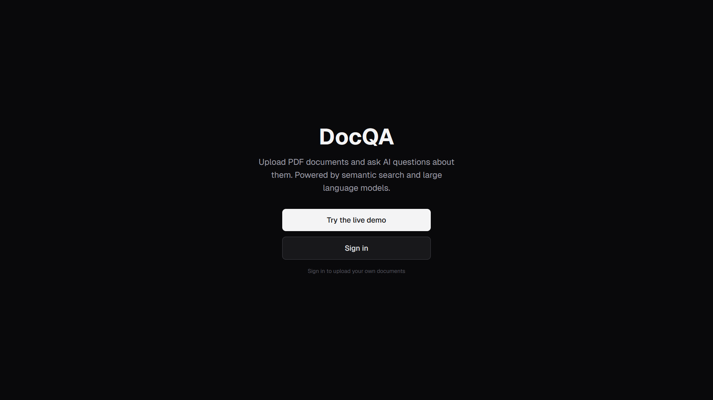
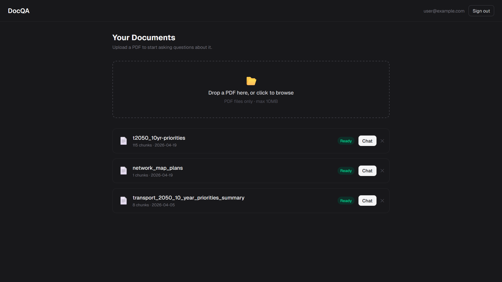
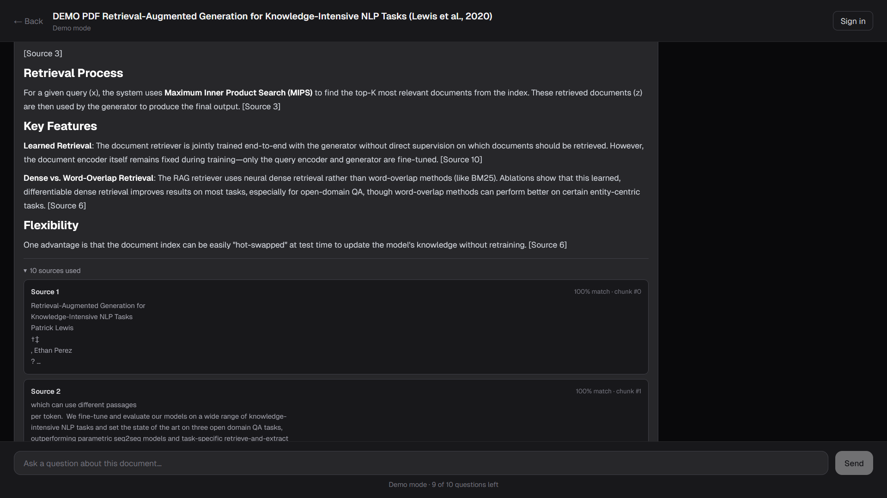
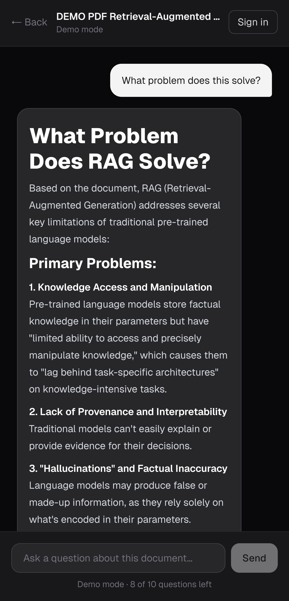

# DocQA — Document Q&A Platform

Upload PDF documents and ask natural language questions about them. Answers are grounded in the actual document content using semantic search, with inline source citations and a guest demo mode for quick exploration.

**Live demo:** https://docqa-vnac.onrender.com



---

## Features

- **Semantic Q&A over PDFs** — Hybrid retrieval combining document lead chunks with top-K cosine similarity
- **Streaming responses** — Token-by-token answers from Claude with markdown rendering
- **Source citations** — Every answer is backed by an expandable panel showing the exact chunks used + their similarity scores
- **Guest demo mode** — Recruiters and visitors can try the app instantly with a pre-loaded paper, no sign-in required (rate-limited per IP)
- **Authenticated uploads** — Sign in with GitHub to upload your own documents, scoped per-user at the database level
- **Responsive design** — Works on desktop and mobile

---

## A look around

Sign in with GitHub and you get a personal document library. Drop in a PDF, wait a few seconds for it to chunk and embed, then start chatting once it shows Ready. Documents are private to each user.



Don't want to sign in, try the live demo which comes with a pre-loaded paper (the original RAG paper by Lewis et al.). Ask a question and the answer streams in with markdown formatting. Each answer also has an expandable sources panel that shows every chunk the model used, ranked by cosine similarity, so you can check the grounding for anything it tells you.



Same demo on a phone. Everything reflows cleanly, including the sources panel.

<p align="center">
  
</p>

---

## How it works

1. User uploads a PDF → stored in AWS S3 via presigned URL
2. Text is extracted, split into chunks (~500 tokens with 50-token overlap), and embedded using OpenAI's `text-embedding-3-small`
3. Embeddings are stored in PostgreSQL using the pgvector extension
4. On query: the question is embedded; **hybrid retrieval** fetches the document's first 3 chunks (for high-level context) plus the top-K most semantically similar chunks via cosine similarity
5. Retrieved chunks are passed as context to Anthropic Claude, which streams back a grounded answer with source references attached as message metadata

---

## Tech stack

- **Framework:** Next.js 16 (App Router, TypeScript, React 19)
- **Auth:** NextAuth.js with GitHub OAuth, JWT sessions
- **Database:** PostgreSQL + pgvector (Neon serverless)
- **ORM:** Prisma 7
- **File storage:** AWS S3 (presigned URLs for direct browser uploads)
- **Embeddings:** OpenAI `text-embedding-3-small` (1536-dim)
- **LLM:** Anthropic Claude Haiku (streaming via Vercel AI SDK)
- **Markdown rendering:** react-markdown + remark-gfm
- **Styling:** Tailwind CSS 4 with `@tailwindcss/typography`
- **Deployment:** Docker (multi-stage build), Render
- **Testing:** Vitest unit tests (chunking, rate limiting, hybrid retrieval merge) and Playwright end-to-end tests of the demo flow against a local mock of the OpenAI and Anthropic APIs
- **CI/CD:** GitHub Actions (lint, type check and tests on every PR and push; deploys to Render only after all checks pass on `main`)

---

## Architecture

```
Browser → Next.js API Routes → AWS S3 (file storage)
                             → Neon Postgres + pgvector (chunks + embeddings)
                             → OpenAI API (embeddings)
                             → Anthropic API (chat completions)
```

**Upload flow:**
```
Browser → POST /api/upload → returns S3 presigned URL + Document row
       → PUT directly to S3 (bypasses our server)
       → POST /api/process → extract text → chunk → embed (batched)
                          → store chunks + vectors in pgvector
                          → mark Document as READY
```

**Query flow (authenticated):**
```
Browser → POST /api/chat → embed query
                        → fetch first 3 chunks (lead context)
                        → top-K cosine similarity search
                        → merge & dedupe → build prompt with context
                        → stream response from Claude
                        → attach sources to message metadata
```

**Demo flow (no auth):**
```
Browser → POST /api/chat-demo → IP rate-limit check (10/hour, 30/day)
                             → same retrieval/generation as authenticated path
                             → scoped to a single pre-loaded demo document
```

---

## Project structure

```
app/
├── (auth)/login/        — sign-in page
├── api/
│   ├── auth/            — NextAuth handlers
│   ├── upload/          — generate S3 presigned URL
│   ├── process/         — extract/chunk/embed pipeline
│   ├── chat/            — authenticated RAG endpoint
│   ├── chat-demo/       — guest RAG endpoint (rate-limited)
│   └── documents/       — list/delete user's docs
├── demo/                — guest demo (document list + chat)
├── documents/           — authenticated document library + chat
└── page.tsx             — landing page

components/
├── ChatWindow.tsx       — streaming chat UI with sources panel
├── DocumentCard.tsx     — list item with status + actions
├── UploadDropzone.tsx   — drag-and-drop upload
└── ...

lib/
├── auth.ts              — NextAuth config
├── chunker.ts           — recursive text splitter
├── embeddings.ts        — OpenAI client wrappers
├── retrieval.ts         — hybrid retrieval (lead + semantic)
├── merge-chunks.ts      — pure merge/dedupe of lead + semantic results
├── rate-limit.ts        — in-memory IP rate limiter
├── prisma.ts            — Prisma singleton
└── s3.ts                — AWS S3 client
```

---

## Running locally

**Prerequisites:** Node.js 22+, Docker

1. Clone the repo
   ```bash
   git clone https://github.com/JasrajCode/docqa
   cd docqa
   ```

2. Install dependencies
   ```bash
   npm install
   ```

3. Create a `.env` file with:
   - `DATABASE_URL` — PostgreSQL connection string
   - `NEXTAUTH_SECRET` — random secret string
   - `NEXTAUTH_URL` — `http://localhost:3000`
   - `GITHUB_CLIENT_ID` / `GITHUB_CLIENT_SECRET` — GitHub OAuth app credentials (callback: `http://localhost:3000/api/auth/callback/github`)
   - `OPENAI_API_KEY` — OpenAI API key
   - `ANTHROPIC_API_KEY` — Anthropic API key
   - `AWS_REGION` / `AWS_ACCESS_KEY_ID` / `AWS_SECRET_ACCESS_KEY` / `S3_BUCKET_NAME` — AWS S3 credentials
   - `DEMO_USER_ID` / `DEMO_DOCUMENT_ID` *(optional)* — IDs for the demo PDF; required only if you want the `/demo` route to work

4. Start the local Postgres (with pgvector pre-installed)
   ```bash
   docker compose up -d db
   ```

5. Run migrations
   ```bash
   npx prisma migrate deploy
   ```

6. Start the dev server
   ```bash
   npm run dev
   ```

Visit `http://localhost:3000`.

Run the unit tests with `npm test` (or `npm run test:watch` while developing). Test files sit next to the code they cover, e.g. `lib/chunker.test.ts`.

The end-to-end tests in `e2e/` drive the production build in a real browser. They use a throwaway database and a small local server that stands in for the OpenAI and Anthropic APIs, so they cost nothing and give the same result every run. The app reaches the stand-in through `OPENAI_BASE_URL` and `ANTHROPIC_BASE_URL`, so no test-only code ships in the app.

```bash
npx playwright install chromium   # first time only
docker compose up -d db
npm run test:e2e
```

---

## Deployment

The app is containerized with a multi-stage Docker build (non-root production runner, Next.js standalone output) and deployed to Render. The database is hosted on Neon (free serverless Postgres with pgvector).

GitHub Actions runs ESLint, the TypeScript compiler and the Vitest suite on every pull request and push. A second job builds the app and runs the Playwright tests against a Postgres service container. On `main`, a deploy job waits for both, then triggers a Render deploy hook, which pulls the latest code, rebuilds the image and rolls out the new version. If any check fails, nothing is deployed.
